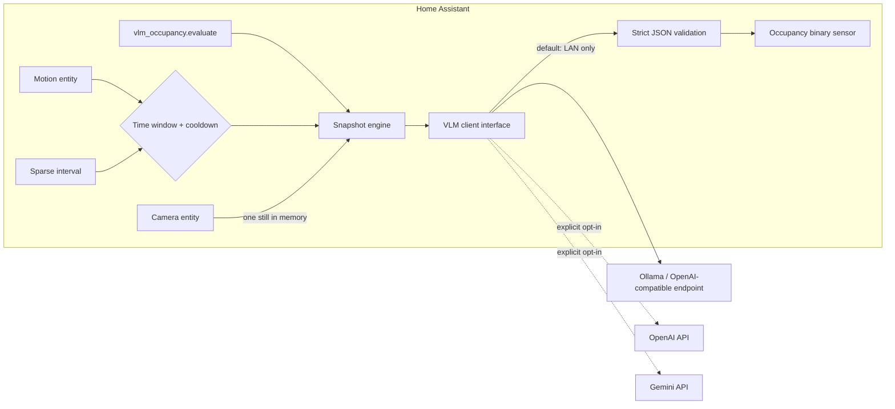
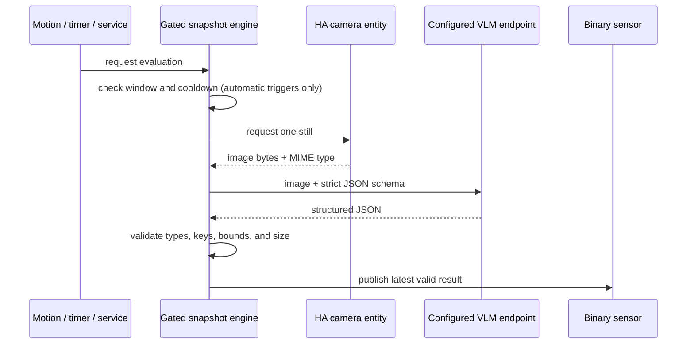

# VLM Bed & Wheelchair Occupancy Sensor


A local-first Home Assistant custom integration that evaluates **single camera
stills**, not video streams, to estimate:

- whether a person is in bed, including partial blanket occlusion;
- whether a wheelchair appears parked beside the bed; and
- one combined confidence score plus a short visual explanation.

The primary entity is an `occupancy` binary sensor. Its state is the `in_bed`
classification; `wheelchair_parked`, `confidence`, and `reasoning` are attributes.

> [!IMPORTANT]
> This is an assistive home-automation signal, not a medical device or a
> life-safety system. A single image can show wheelchair placement but cannot
> prove that an object is stationary over time. Never use the result as the sole
> basis for emergency, fall, restraint, or clinical decisions.

## Architecture



No camera file is created by the integration. The snapshot travels as bytes from
the camera entity to the selected client, is base64-encoded in process memory,
and is discarded after the request completes. In particular, the integration
never writes to `/config/www`, `/media`, or another web-served directory.



### Trigger behavior

| Source | Time window | Cooldown | Notes |
|---|---:|---:|---|
| Motion changes to `on` | Enforced | Enforced | One still; no evaluation on motion clearing |
| Sparse poll interval | Enforced | Enforced | `0` disables polling |
| `vlm_occupancy.evaluate` | Bypassed | Enforced | An explicit user/automation request |
| Service call with `force: true` | Bypassed | Bypassed | Useful for deliberate testing only |

Equal window start and end times mean all day. Overnight windows such as 21:00
to 08:00 are supported. If motion and polling are both omitted/disabled, the
integration is service-only and makes no automatic requests.

## Installation

### HACS (recommended)

1. In HACS, open the three-dot menu and select **Custom repositories**.
2. Add `https://github.com/foobarnes/vlm-occupancy` with category
   **Integration**.
3. Open the repository in HACS and select **Download**.
4. Restart Home Assistant.
5. Open **Settings → Devices & services → Add integration** and search for
   **VLM Bed & Wheelchair Occupancy Sensor**.

HACS will surface later GitHub releases as Home Assistant updates. Installing an
integration update still requires a Home Assistant restart.

### Manual

1. Copy `custom_components/vlm_occupancy` into the same path under your Home
   Assistant configuration directory.
2. Restart Home Assistant.
3. Add the integration from **Settings → Devices & services**.

Choose the camera, provider, model, automatic window, and optional motion entity.
Ollama is selected by default. The setup form also shows the default evaluation
prompt so it can be tailored to the room layout.

For a local Ollama server, pull a vision-capable model first, for example:

```sh
ollama pull llava
```

The default endpoint is `http://localhost:11434/v1`. If Home Assistant runs in a
container or VM, `localhost` refers to that container or VM; use the Ollama
host's private LAN address instead. Keep the endpoint firewalled from untrusted
networks.

## Credentials without config-entry secrets

Home Assistant config entries are not an encrypted secret vault. This
integration therefore stores only a **credential reference**, never the API key,
in its config entry. There are two supported sources:

### Home Assistant `secrets.yaml` (recommended for HA OS)

```yaml
# secrets.yaml
bedroom_gemini_api_key: "replace-me"
```

```yaml
# configuration.yaml
vlm_occupancy:
  api_keys:
    bedroom_gemini: !secret bedroom_gemini_api_key
```

Restart Home Assistant, then enter `bedroom_gemini` as the credential reference
in the UI. The resolved value exists only in Home Assistant process memory and
is not copied into the config entry.

### Environment variable

Set `OPENAI_API_KEY`, `GEMINI_API_KEY`, or another environment variable in the
Home Assistant process, then enter that variable's name in the UI. An
unauthenticated local Ollama endpoint needs no credential reference.

Cloud providers are always explicit opt-in. Selecting OpenAI or Gemini sends the
current bedroom still to that provider under its account and data-handling
terms. The integration never falls back from local inference to a cloud service.
Cloud endpoints must use HTTPS; endpoint URLs containing credentials, query
parameters, or fragments are rejected.

## Structured output

### Customize the evaluation prompt

Open **Settings → Devices & services → VLM Bed & Wheelchair Occupancy Sensor**,
select **Configure** on the integration entry, edit the prompt, and save. The
entry reloads automatically, so the next manual or automatic evaluation uses
the new prompt. Existing installations receive the documented default until a
custom prompt is saved.

Use the editable portion for scene-specific guidance, such as which side of the
bed normally holds the wheelchair or which blanket shapes commonly cause false
positives. The integration always appends its prompt-injection warning and
required JSON-output instructions; those safeguards are not editable.

Every provider receives a schema equivalent to:

```json
{
  "in_bed": true,
  "wheelchair_parked": true,
  "confidence": 0.92,
  "reasoning": "Blanket contour and visible head indicate a person; wheelchair is beside the bed."
}
```

Output is rejected unless it has exactly these fields, real booleans, a
confidence between `0` and `1`, and a non-empty bounded reasoning string. A
rejected result never replaces the last valid sensor state.

## Automation examples

### Motion-triggered, time-gated evaluation

The integration can subscribe to a motion entity itself. If you prefer to keep
the gate visible in an automation, disable the integration's motion trigger and
use:

```yaml
alias: Evaluate bedroom occupancy after motion
triggers:
  - trigger: state
    entity_id: binary_sensor.bedroom_motion
    from: "off"
    to: "on"
conditions:
  - condition: template
    value_template: >-
      
      {{ t >= strptime('21:00', '%H:%M').time()
         or t < strptime('08:00', '%H:%M').time() }}
actions:
  - action: vlm_occupancy.evaluate
    data: {}
mode: single
```

### Sparse scheduled evaluation

```yaml
alias: Sparse overnight bedroom check
triggers:
  - trigger: time_pattern
    minutes: "/15"
conditions:
  - condition: template
    value_template: >-
      
      {{ t >= strptime('21:00', '%H:%M').time()
         or t < strptime('08:00', '%H:%M').time() }}
actions:
  - action: vlm_occupancy.evaluate
mode: single
```

### Use the wheelchair attribute

```yaml
alias: Wheelchair not parked when bed becomes occupied
triggers:
  - trigger: state
    entity_id: binary_sensor.bedroom_occupancy_bed_occupancy
    to: "on"
conditions:
  - condition: template
    value_template: >-
      {{ state_attr('binary_sensor.bedroom_occupancy_bed_occupancy',
                    'wheelchair_parked') == false }}
  - condition: numeric_state
    entity_id: binary_sensor.bedroom_occupancy_bed_occupancy
    attribute: confidence
    above: 0.8
actions:
  - action: notify.mobile_app_caregiver_phone
    data:
      title: "Bedroom check"
      message: "Bed appears occupied and the wheelchair is not in its expected place."
mode: single
```

Entity IDs are assigned by Home Assistant and may differ from the examples.

## Privacy and security model

- **No streaming:** only a camera still requested for a specific evaluation.
- **No snapshot files:** images remain in memory and are never placed in a web
  root. The code also caps accepted images at 20 MiB.
- **No stored raw keys:** config entries retain a reference to a `!secret`-backed
  alias or environment variable. Keys are added only to request headers.
- **No sensitive error bodies:** HTTP response bodies, tokens, request payloads,
  and image data are never included in exceptions or logs. Automatic failures
  log only a generic message.
- **No implicit cloud fallback:** local inference remains local unless the user
  deliberately changes provider configuration.
- **Prompt-injection boundary:** the prompt treats visible image text as
  untrusted. Model output is data-only and strictly validated; it cannot call
  Home Assistant services.

The `reasoning` attribute is intentionally short but may still describe a
private room. Home Assistant's recorder may persist entity states and
attributes. If that is undesirable, exclude this entity from `recorder` or set a
short retention policy. Also restrict dashboard and log access as you would for
the underlying camera.

## Providers

| Provider | Default endpoint | Default model | Image destination |
|---|---|---|---|
| Ollama / compatible | `http://localhost:11434/v1` | `llava` | Local endpoint |
| OpenAI | `https://api.openai.com/v1` | `gpt-4.1-mini` | OpenAI cloud |
| Gemini | `https://generativelanguage.googleapis.com/v1beta` | `gemini-2.5-flash` | Google cloud |

OpenAI-compatible servers must accept Chat Completions image content and JSON
Schema response format. Provider capabilities vary; choose a vision model that
supports both. The Gemini client uses `generateContent` with a response schema.

## Alternatives & Architectural Trade-offs

### The "No-Code" Native YAML + Blueprint Approach

Roughly 90% of this behavior can be assembled from a trigger-based template
binary sensor, `camera.snapshot`, the built-in Google Gemini integration's
`google_generative_ai_conversation.generate_content` action, and normal
automations. A blueprint can expose the camera, motion entity, time window, and
prompt as inputs. The template entity's action stores the returned JSON in a
response variable, then renders `in_bed` as state and the other fields as
attributes.

A condensed pattern looks like this (service names reflect current Home
Assistant naming):

```yaml
homeassistant:
  allowlist_external_dirs:
    - /tmp

shell_command:
  remove_private_bed_snapshot: "rm -f /tmp/ha_vlm_bed_snapshot.jpg"

template:
  - triggers:
      - trigger: state
        entity_id: binary_sensor.bedroom_motion
        to: "on"
    conditions:
      - condition: template
        value_template: >-
          
          {{ t >= strptime('21:00', '%H:%M').time()
             or t < strptime('08:00', '%H:%M').time() }}
    actions:
      - action: shell_command.remove_private_bed_snapshot
      - action: camera.snapshot
        target:
          entity_id: camera.bedroom
        data:
          filename: /tmp/ha_vlm_bed_snapshot.jpg
      - action: google_generative_ai_conversation.generate_content
        data:
          filenames: /tmp/ha_vlm_bed_snapshot.jpg
          prompt: >-
            Return only JSON with exactly: in_bed (boolean),
            wheelchair_parked (boolean), confidence (0..1), and brief reasoning.
        response_variable: generated
      - variables:
          observation: "{{ generated.text | from_json }}"
      - action: shell_command.remove_private_bed_snapshot
    binary_sensor:
      - name: YAML Bed Occupancy
        unique_id: yaml_bed_occupancy
        device_class: occupancy
        state: "{{ observation.in_bed | bool }}"
        attributes:
          wheelchair_parked: "{{ observation.wheelchair_parked | bool }}"
          confidence: "{{ observation.confidence | float }}"
          reasoning: "{{ observation.reasoning }}"
```

This avoids custom Python, but it is cloud-first, writes a temporary file, and
requires careful cleanup, allowlisting, JSON failure handling, cooldown logic,
and state preservation. Never put the snapshot under `/config/www`. Home
Assistant does not provide `finally` semantics for this action chain, so a
provider failure can leave the file until the next pre-clean or OS cleanup; use
a RAM-backed `/tmp` and account for that limitation. Home Assistant's newer AI
Task building block may further simplify attachment and structured-output
handling on versions/providers that support it.

### Physical Sensor Fusion (No Cameras)

A pressure mat, load-cell bed frame, or under-mattress piezo sensor can provide
the bed signal. A BLE beacon fixed to the wheelchair, combined with one or more
room proxies, can estimate whether the chair is in the expected room or beside
the bed. Fuse those two entities in a native template sensor.

This is 100% local, works in darkness, sends no imagery anywhere, and is often
more deterministic after calibration. Trade-offs are extra hardware, wiring,
battery maintenance, pressure-threshold tuning, BLE multipath/RSSI noise, and
limited ability to distinguish a person from another heavy load without richer
sensor fusion. For privacy-sensitive or safety-adjacent deployments, this is the
preferred starting point.

### Why this Custom Component Exists

The component earns its maintenance cost when several concerns must behave as
one unit: snapshot acquisition, overnight windows, motion/sparse triggers,
debounce, provider selection, strict schema validation, last-known-good state,
credential indirection, and sanitized failures. Keeping those behaviors in a
small Python integration gives one state owner and one error boundary instead of
a large chain of YAML variables, temporary files, helper entities, shell
commands, and duplicated automation conditions.

If one camera, one trigger, and Gemini's native action are sufficient, prefer the
YAML/blueprint route. If inference privacy must be absolute, prefer physical
sensors. Use this component when local vision's occlusion handling and unified
state management justify the additional code.

## Development validation

From the repository root:

```sh
python3 -m compileall custom_components/vlm_occupancy
python3 -m json.tool custom_components/vlm_occupancy/manifest.json >/dev/null
python3 -m json.tool custom_components/vlm_occupancy/strings.json >/dev/null
```

## License

MIT
